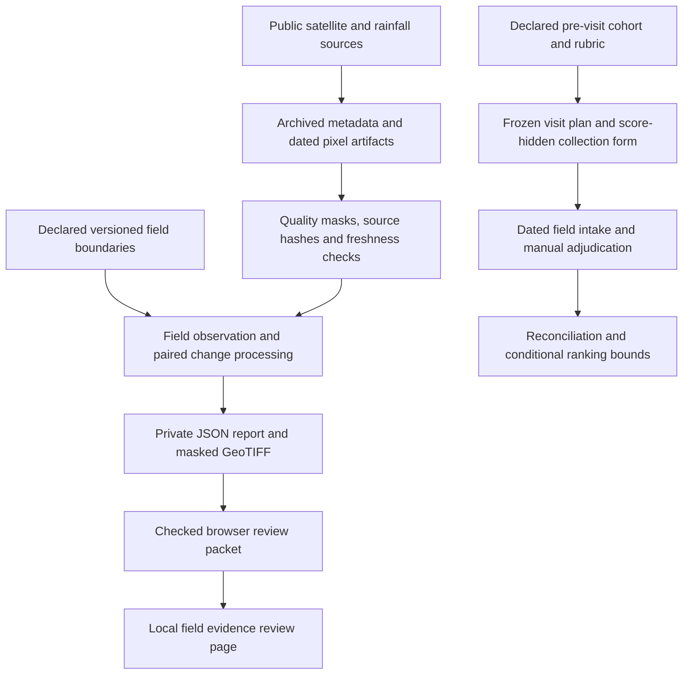

# Vantage: the work so far, step by step

Updated 24 October 2026. Start here for a connected explanation of the project.
Vantage is part of [Lillie US](https://github.com/Ibekwemmanuel7/Lillie_US).

**Current status:** a working local agricultural geospatial research prototype
with reproducible satellite processing, explicit evidence-quality gates, private
field-data tools and a browser review interface. It is not yet an independently
validated agricultural service. Uganda is the first active pilot; Vantage is
the product, not a Uganda-only application. Texas is deferred. Forestry remains
with Vepris. No CropSight code or validation is inherited.

## 1. We defined the decision before choosing models

The practical question is: **which fields and zones deserve a closer look on the
next scouting round?** A map supports an adviser or field team investigating a
change; it does not identify a disease, explain a nutrient deficiency or prescribe
irrigation from imagery alone.

The original market definition proposed an independent cotton consultant in
Hale/Floyd counties, Texas. You subsequently prioritized Africa and Uganda.
The original Texas documents remain as historical design work, not today's
active pilot plan. Crops, calendars and validation cannot transfer between markets
without separate evidence.

Read: [original market definition](portfolio/INITIAL_MARKET.md),
[Uganda roadmap](africa/ROADMAP.md), [product scope](portfolio/SCOPE.md).

## 2. We investigated positioning and the partner opportunity

We documented market hypotheses, a bounded pilot, historical-event research and
how Vantage could contribute a geospatial component to David's broader platform.
Uganda is the proposed first integration geography; Nigeria and the Philippines
are future candidates, not implemented deployments.

The proposed long-term scope includes vegetation monitoring, rainfall/weather
context, agricultural land changes and reporting useful to field teams and
potential public-sector stakeholders. Research and a partnership discussion do
not establish a paying customer, government contract, partner API or validated
farmer benefit. No government engagement or production integration is established.

Read: [partner platform brief](integration/PARTNER_PLATFORM.md),
[IDEA fit assessment](idea/ASSESSMENT.md), [pilot proposal](idea/PILOT_PROPOSAL.md),
[historical evidence program](strategy/HISTORICAL_EVIDENCE.md).

## 3. We designed the architecture and built local components

The implemented workflow is currently file-based processing plus a loopback web
server and browser-local review. It is a collection of connected research tools,
with several operator-reviewed handoffs, not an automatic end-to-end service.



The diagram describes component relationships. In particular, a change map is
**not automatically converted** into the frozen cohort, a priority score or a
verified field finding. Those links require reviewed boundaries, crop/season
context, a defined scoring protocol and independent observations.

The production target proposes authenticated APIs, PostgreSQL/PostGIS, private
raster storage, workers, a job queue and authorized map delivery. Those are
architecture targets, not deployed infrastructure or an existing partner API.

Read: [MVP architecture and data model](mvp/ARCHITECTURE.md),
[production architecture target](strategy/PRODUCTION_ARCHITECTURE.md),
[imagery architecture](ml/ARCHITECTURE.md).

## 4. We processed actual public satellite evidence

The research includes dated Sentinel-2 optical observations over Uganda study
boxes and historical examples, plus WorldCover and CHIRPS context in the earlier
reconstruction. Sentinel-1 radar work was added later. These are different
sources with different interpretations:

| Evidence | What it contributes here | What it does not establish |
| --- | --- | --- |
| Optical reflectance and NDVI | Dated observed vegetation patterns and changes | A diagnosed cause, yield loss or management prescription |
| Quality masks | Which pixels are accepted or excluded | That excluded or missing pixels are healthy |
| CHIRPS rainfall context | Historical rainfall comparison in the earlier reconstruction | A live weather forecast or field water requirement |
| WorldCover | Historical land-cover context | Confirmed current crop identity or a farmer boundary |
| Radar VV/VH | Observed radar features with additional geometric checks | Interchangeability with NDVI or independent crop-health truth |

The Uganda study boxes are **not consented farm boundaries**. Public imagery and
geographic overlap alone do not establish ownership, crop identity or damage.
The Texas Plainview work includes catalog feasibility; it must not be presented
as a completed farm damage validation. Historical event reconstruction does not
prove Vantage could have issued an operational warning at that historical time.

Read: [earlier reconstruction operations](idea/OPERATIONS.md),
[imagery dataset card](ml/DATASET_CARD.md),
[recent inventory](integration/RECENT_INVENTORY.md),
[recent pixel processing](integration/RECENT_PIXELS.md).

## 5. We made missing and stale evidence explicit

The frozen October 2026 sequence processed 18 scenes across Iganga, Lira and
Kasese. Five passed the whole-box coverage rule, but the latest qualifying
observations were stale at the recorded 23 October cutoff. The latest selected
20 October acquisitions yielded zero accepted pixels in all three boxes under
the established mask recipe. These are archived results at that cutoff, not a
statement about today's fields.

The quality audit attributed exclusions to source cloud-related SCL classes;
it did not replace missing observations with healthy-field assessments.
Observation age and accepted pixel coverage are carried into reports.

Read: [recent sequence](integration/RECENT_SEQUENCE.md),
[quality audit and cloud gaps](integration/CLOUD_GAPS.md).

## 6. We tested ML rather than assuming it would improve results

An exploratory earlier-year Isolation Forest novelty model and a separate
optical-history regression experiment were fitted. These are not supervised
disease, yield or verified crop-health models.

The cloud-gap work compares learned predictions with simple persistence, keeps
hidden targets out of model history, and separates location/year development
cohorts. The learned regression's clear-transition validation MAE was about
0.0708 versus persistence's 0.0606; lower is better, so that comparison favored
persistence. Both isolated and sequential transferred-gap validation protocols
had zero supported Lira gap predictions under the temporal support rules.
The learned model was **not promoted**. An already inspected development test
is not an untouched final test.

Foundation models remain benchmark candidates requiring compatible inputs and
independent evaluation. Our limited optical inputs do not become a compatible
multiband foundation-model dataset merely by saving images.

Read: [model card](ml/MODEL_CARD.md),
[learned gap baseline](integration/GAP_LEARNED_BASELINE.md),
[protocol comparison](integration/GAP_PROTOCOL_COMPARISON.md).

## 7. We investigated radar support for optical cloud gaps

We checked radar catalog availability, extracted same-track radar measurements,
and added surface-slope, source-annotation, local viewing-geometry and bounded
terrain-visibility checks. Radar/optical sample preparation keeps radar features,
observed optical targets and unlabeled cloud gaps separate.

The prepared sample manifest has four Iganga training-reference dates and three
Lira validation-reference dates. Its many correlated pixel-date pairs are not
independent farms or verified crop labels. Training eligibility remains disabled.
Independent processor comparisons are pending, and no radar-assisted gap model
or operational cloud-filled imagery has been produced. The authenticated CDSE
fetcher was implemented and dry-run tested; no real provider request was submitted
in that implementation run. Bounded terrain checks do not certify full radar
illumination or agricultural validity.

Read: [radar availability](integration/GAP_RADAR_AVAILABILITY.md),
[Lira checks](integration/LIRA_VISIBILITY.md),
[Iganga checks](integration/IGANGA_RADAR_QUALITY.md),
[radar-optical samples](integration/RADAR_OPTICAL_SAMPLES.md),
[provider export workflow](integration/CDSE_EXPORT_FETCH.md).

## 8. We built field evidence intake and prospective evaluation tools

This is the ground-evidence branch of the project:

1. **Intake:** check dated scouting, planting and harvest records, provenance,
   permissions, field/version links and harvest units. Public reports remain
   investigation leads. A partial harvest is not extrapolated to the full field.
2. **Freeze before visits:** record a declared cohort, source availability,
   baseline/model scores and finding rubric; sample flagged/unflagged units.
   Collection forms hide scores and strata to reduce bias.
3. **Reconcile returned records:** retain every selected unit as missing,
   withheld or ready for adjudication. Reject conflicting boundary links and
   duplicate visits. Missing visits do not become negative findings.
4. **Review adjudication declarations:** require traceable references, dates and
   distinct personnel before using a declared outcome in conditional analysis.
   The software cannot authenticate real independence or field truth.
5. **Compare rankings:** bound the possible useful-finding precision and paired
   model/baseline difference while unresolved outcomes remain unknown. Shared
   ranked units cancel correctly in the paired difference.

These bounds are not confidence intervals or estimates of general agricultural
accuracy. The older complete-cohort evaluator is a separate tool: it cannot
treat the stratified partial sample as a fully observed cohort. Neither intake
nor reconciliation automatically creates model-training labels.

Read: [field intake](integration/FIELD_EVIDENCE_INTAKE.md),
[frozen visit protocol](integration/FIELD_VISIT_PROTOCOL.md),
[ranking bounds](integration/SCOUTING_BOUNDS.md),
[evaluation protocol](africa/EVALUATION.md).

## 9. We connected observed satellite pixels to field geometry

The newer field adapter accepts valid Polygon/MultiPolygon GeoJSON, including
holes. It checks closure, topology, declared boundary versions and complete
raster footprint coverage. It summarizes observed NDVI by field rather than
treating an entire study box as one farm.

The dated comparison requires identical grids and the same declared processing
recipe. It uses only pixels valid on both dates. This prevents different clear
areas from masquerading as a measured change between independent date medians.
Low common coverage, too few pixels, stale/latest observations and excessive
date gaps withhold the change map. Defaults are declared research policies,
not agronomically validated thresholds.

Outputs are a traceable JSON report and masked GeoTIFF. Missing/withheld pixels
are nodata; valid zero change stays distinct. Real consented field boundaries
have not been supplied, so this branch has been tested with synthetic inputs.

Read: [field pixels](integration/FIELD_PIXELS.md),
[dated field change](integration/FIELD_CHANGE.md).

## 10. We added the private field evidence review interface

The workspace links to a page where a user opens a locally prepared review
packet. It shows explicit UTC dates, a numerical change-map overview, field
support, withheld states and provenance. It reads the file in browser memory,
without uploading it or creating a persistent shared field record.

The overview is bounded and sampled; it can omit small features. Full-resolution
statistics stay in the report, and the original GeoTIFF remains the GIS source.
Selecting a field changes details; the map remains the union of supported fields.
No invented selected-field outline or operational priority is displayed.

Read: [field review usage guide](integration/FIELD_REVIEW_UI.md).

## 11. How to use the work in order

### A. View the existing workspace

From PowerShell:

```powershell
cd C:\Users\taylo\Lillie_US\Vantage
python scripts/serve_demo.py --port 8917
```

Open `http://127.0.0.1:8917/` for the scouting workspace, then **Field evidence
review** for the new local packet viewer. It starts empty until you choose a
packet. The separate analyst desk is `/research.html`. Keep the server running
while browsing; use Ctrl+C to stop it. No production deployment is required.

The existing dashboard is historical, not a live farming service. Generated
imagery previews require their local artifacts; Git alone does not contain all
rasters. If a preview or source is unavailable, do not replace it with invented
imagery. Dependency sets and rebuild instructions are in the linked component
guides. Cached web serving needs only Python's standard library; scientific
processing needs the relevant optional requirements files.

### B. Run a real field comparison once the inputs exist

1. Obtain consented, reviewed boundaries and confirmed crop/season context.
2. Follow the field-pixel guide to prepare the boundary GeoJSON.
3. Obtain two suitable original observed NDVI artifacts from the existing
   processing pipeline; retain their source reports, hashes and actual timestamps.
4. Complete a private copy of `configs/field_change_template.json`.
5. Run the comparison and build a browser review packet:

```powershell
python scripts/compare_field_pixels.py outputs/private/field-pair.json --out-dir outputs/private/field-change-001
python scripts/build_field_review.py outputs/private/field-change-001 --out outputs/private/field-review-001.json
```

6. Open that review JSON in the field evidence review page.

The names above are examples of operator-prepared paths. The empty templates
are intentionally not runnable datasets. These commands cannot produce real
farm evidence without the required inputs. Use new output names when rerunning;
the tools refuse to overwrite completed packets.

### C. Run a prospective field study once a partner and protocol exist

Agree the crop calendar, finding rubric, capacity, baseline and held-out design;
prepare the declared cohort, then freeze it **before** field observations:

```powershell
python scripts/field_protocol.py freeze outputs/private/cohort-input.json --out-dir outputs/private/round-001
python scripts/validate_field_evidence.py outputs/private/returned-visits.json --out outputs/private/intake-check-001.json
python scripts/field_protocol.py reconcile outputs/private/round-001/protocol.json outputs/private/returned-visits.json --out outputs/private/reconciliation-001.json
python scripts/compare_scouting_bounds.py outputs/private/round-001/protocol.json outputs/private/returned-visits.json outputs/private/adjudications.json --out outputs/private/bounds-001.json
```

Collection and independent adjudication happen between those commands; the
software does not generate them. This study workflow is not automatically fed
by the change map. Follow the detailed contracts before preparing any input.

## 12. What the test results actually mean

Each implementation guide records its selected checks and date. Recent runs
included 34 tests for dated field change and related components, then 19 Python
and 15 JavaScript tests for private review and selected regressions. Those
suites overlap; do not add their counts into a unique total. They are not a
claim that every repository test was rerun on every change.

Tests cover mathematical behavior, masking, date ordering, geometry, source-hash
consistency, privacy boundaries and overwrite protection. The new review page
was browser-checked with synthetic data at normal and narrow screen widths.
The print dialog was not exercised. The older self-contained evidence-review
HTML had a separate blocked browser preview and does not inherit the new page's
visual QA.

Software tests do **not** prove crop-disease accuracy, yield prediction, water
savings, farmer income improvement or government readiness. Actual independent
field outcomes remain **zero**.

## 13. What still has to happen

| Next requirement | Why it matters |
| --- | --- |
| A Uganda field/advisory partner and consented boundaries | Establishes real users, field identity and access to evidence |
| Confirmed crop calendars and management context | Separates expected seasonal changes from unexpected observations |
| Denser suitable observations across locations/seasons | Tests operational coverage and transfer beyond the study boxes |
| Independent dated scouting/harvest outcomes | Makes meaningful agricultural validation possible |
| Independent radar processor comparisons and untouched evaluation | Supports trustworthy radar/ML benchmarks |
| Prospective utility study with an agreed analysis plan | Tests whether the tool improves the actual scouting decision |
| Authenticated partner integration and durable records | Makes multi-user production use possible |

Internet reports can help discover historical cases and leads, but they cannot
automatically supply field-level truth. Weather forecasts, validated farmland
change, yield forecasting, resource prescriptions and government reporting are
not a completed integrated product today. Build and validate each module against
its intended decision before marketing the claimed benefit.

Code and documentation updates are committed and pushed to the Vantage GitHub
repository after relevant verification. Generated rasters, weights, private
field records, QA packets and credentials stay outside Git. Public deployment
and contacting partners are separate actions, not consequences of a Git push.
