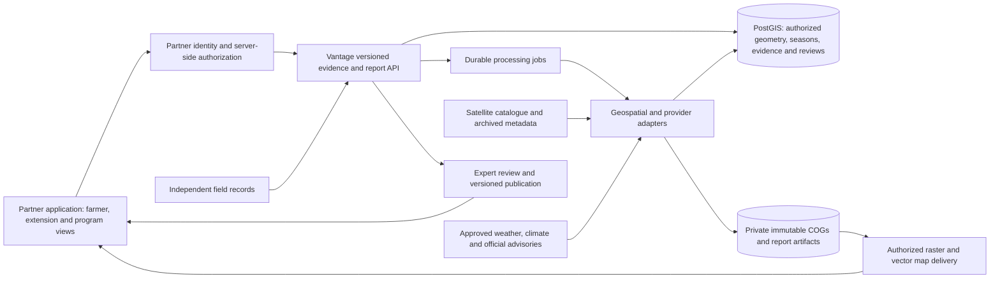

# Vantage inside a partner application: Uganda integration brief

22 October 2026. Product/design proposal within
[Lillie US](https://github.com/Ibekwemmanuel7/Lillie_US).

## Purpose and confirmed scope

Vantage remains the agricultural geospatial product. Its maps, dated evidence
and reviewed reports should appear inside David's broader application through
an integration boundary. Uganda is the first integration market. The Philippines
and Nigeria are future candidates identified by the owner, not implemented
markets or commitments. Texas remains deferred.

The owner reports a meeting with David and a possible government proposal.
This establishes a development direction, not a government customer, awarded
contract, formal IDEA/LiveBeyond partnership or approved integration. The target
Ugandan institution, program owner, reviewers, platform technology, interface,
hosting and budget still need confirmation.

Proposed positioning: **Vantage supplies agricultural maps and traceable evidence
that help farmers, extension teams and program managers decide what to inspect
and understand local growing conditions.** Start from decisions and service
quality rather than promising every possible satellite-derived variable.

## Three connected user experiences

| User | Main questions | Proposed embedded output |
| --- | --- | --- |
| Farmer or assisted farmer group | What changed around my field? How recent is the evidence? What should I ask the extension worker to check? | Simple field/locality view, dated optical coverage, reviewed field questions, weather context and a printable/shareable short brief |
| Extension team | Which eligible fields/areas need investigation? Why? What did the last visit find? | Worklist linked to maps, side-by-side dates, seasonal trajectory, explicit gaps, visit notes and follow-up records |
| Government/program team | Where are agricultural conditions unusual? Which locations lack observations? What has been checked? | Versioned district/subcounty summaries, coverage denominators, reviewed agricultural concerns, investigation status and downloadable evidence annex |

These are different views of common evidence, not one dashboard exposing all
private field records. Government reporting should use approved administrative
boundaries and aggregation rules. A district summary is not evidence that every
field was observed or that every household has the same food access.

The farmer workflow should be tested with actual Ugandan farmers and extension
staff, including assisted use, preferred languages, low-end devices and limited
connectivity. Do not choose a language simply because it is widely spoken
elsewhere in Uganda. Local crop calendars and planting/stage confirmation are
essential; satellite greenness alone does not establish crop identity or cause.

## Capability catalogue and actual implementation status

Machine-readable companion: `configs/partner_uganda_scope.json`. The catalogue
is a proposed scope/status record, not an activated feature configuration.

| Module | Useful measures and maps | Data and validation needed | Actual current status |
| --- | --- | --- | --- |
| Agricultural maps and records | Field/locality geometry, season records, source imagery, observation dates and map legends | Authorized field boundaries; source/effective dates; crop calendars; suitable imagery scale | Local browser field import and historical locality maps implemented; no partner API, durable team register or automatic field matching |
| Crop observation and scouting | Vegetation trajectory, explainable reference differences, usable coverage and dated investigation questions | Crop/stage-aware references; independent field findings; prospective decision evaluation | Historical optical and radar research implemented; field priorities unvalidated; optical evidence remains stale in the Kween case |
| Weather and official advisories | Dated recent weather, short-range forecasts and attributed official warnings | Agreed national/provider feeds, issue/valid times, units, licenses, local verification and forecast skill evaluation | Limited historical rainfall context implemented; operational forecasts and warning relay not integrated |
| Climate and seasonal context | Long-reference rainfall/temperature context, dry-spell indicators and probabilistic seasonal outlooks | Defined reference period, adequate record length/completeness, appropriate native resolution and locally reviewed interpretation | Selected historical rainfall comparisons implemented; no operational seasonal service, long-reference climate dashboard or climate projections |
| Agricultural land-cover change | Persistent transitions involving cropped/bare/built/water-covered agricultural areas, with before/after evidence and uncertainty | Consistent classification method, seasonal matching, independently reviewed reference samples, minimum mapping unit and area uncertainty | Historical WorldCover 2021 cropland context implemented; no validated land-cover-change module or land-use determination |
| Terrain and environmental context | Elevation/slope and agricultural exposure context; approved flood/water overlays where available | Terrain quality, independent hazard validation, dates and source ownership | Bounded radar terrain research implemented; broader water/flood interfaces remain planned |
| Soil, surface temperature and water-use research | Modelled soil context, land-surface temperature, soil-moisture/evapotranspiration estimates where fit for purpose | Suitable spatial scale, exact retrieval/model contract, independent reference measurements and licensing | Not integrated as operational services; no field nutrient diagnosis or irrigation prescription |
| Reports and review | Field/locality brief, extension summary and administrative evidence annex | Agreed templates, responsible reviewer, publication cutoff, distribution/retention permissions | Local reports, research exports and draft notes exist; partner report-generation API and publishing workflow remain proposed |

Weather forecasts are model/provider products, not a capability obtained just
by displaying a satellite scene. Climate reanalysis reconstructs past conditions;
it is not a future forecast. Land-surface temperature is not interchangeable
with air temperature or measured crop stress. Public soil grids do not replace
field soil tests, and coarse weather/soil-moisture grids must not be presented
as measured conditions for a smallholder plot.

Use land **cover** for physically observed classes. Land **use**, tenure and
management require additional records. WorldCover 2020/2021 differences cannot
be treated as pure change because the producer used different algorithm versions.
Forestry stays with Vepris. Vantage may consume agricultural water/flood context
from planned Velo/Vaughan interfaces or approved external providers; it does not
claim those integrations exist. No CropSight code or validation transfers.

## Recommended first embedded release

Choose one district and a manageable set of confirmed fields/localities, one
primary crop workflow and one extension team. These are proposed pilot limits,
to be set with the partner rather than inferred from the existing research boxes.

First deliver one coherent flow: select area → inspect dated imagery and quality
→ see an explainable change or withheld assessment → view attributed weather
context when a feed is connected → record a local finding → prepare a reviewed
weekly report. Show unavailable modules plainly. Do not populate forecast or
climate panels with invented values while feeds are pending.

Suggested ordering:

1. Agree the user decision, data permissions, platform interface and field/crop
   references. Deliver one historical, clearly labeled integration example.
2. Connect current acquisitions and one approved weather feed, add durable
   private field records, observation quality and explicit service deadlines.
3. Run reviewed weekly briefs with field feedback and an independent comparison
   process before declaring operational scouting value.
4. Add climate-reference/seasonal context and independently evaluated
   land-cover-change modules as separate releases.
5. Expand geography or introduce other retrievals/models only after a documented
   local decision, data availability and validation gate.

No fixed delivery date, national coverage, model accuracy or cost commitment is
made by this design. Smallholder field size, mixed pixels, clouds, licensing and
partner review capacity determine feasible delivery.

## Integration architecture

David's application should call a versioned Vantage API and render authorized
layers using its existing map component. Avoid rebuilding his user accounts or
forcing a frontend framework before the platform stack is known. An iframe of
the existing localhost prototype is not a production integration boundary.

Reuse the existing raster/quality logic behind independently executed workers.
The proposed deployment starts with a modular API, database, object storage and
durable jobs, rather than many microservices. Report rendering must not block
interactive map requests. Persist source IDs, checksums, code/config versions,
processing time and failures. Refreshes append observations and report revisions.

Proposed endpoint families (design only; not implemented or advertised as live):

- `GET /v1/capabilities`: available modules, geographies, versions and limitations.
- `GET /v1/areas/{area_id}/evidence?as_of=...`: dated, authorized observations and
  assessments, including missing/withheld states.
- `GET /v1/areas/{area_id}/layers`: legends, source resolution, units, valid time,
  authorized tile links and current quality status.
- `POST /v1/reports`: create an idempotent asynchronous draft-report job for an
  authorized area, cutoff, template and audience; return a job ID.
- `GET /v1/jobs/{job_id}` and `GET /v1/reports/{report_id}`: processing state and
  versioned artifacts; submission never implies completion or expert approval.
- `POST /v1/field-observations`: private dated findings, provenance and review
  status; a submission is not automatically an independent training label.

Agree the exact OpenAPI contract and sample payloads with David's developer
before implementing routes. Authentication and area/tenant permissions must be
enforced on the backend for records, jobs, reports, exports and map assets, not
only through hidden frontend controls. Client-supplied organization IDs are not
authorization. Keep private locations and field records out of public URLs and
public report bundles. Any clinical integration is a separate project; patient
records are unnecessary for the initial agricultural module.

## Standards and information contract

Use standards where they support an actual interoperability requirement:

- STAC metadata and COG assets for discoverable, traceable raster evidence.
- RFC 7946 GeoJSON for geographic interchange; valid polygon versions and
  appropriate projected/geodesic methods for area calculations.
- Versioned OpenAPI for the partner service. Use OGC API Features/Tiles/Maps
  or a required legacy service at the government interface where needed;
  standards conformance requires implementation and testing, not this document.
- UTC machine timestamps plus explicit local display zones. Record acquisition,
  first-known availability, processing, forecast issue/valid time and decision
  cutoff separately. Never use a future forecast revision in a historical replay.
- Provider-native resolution, analysis resolution, units, masks, licenses,
  attribution, uncertainty, valid fraction and reasons for withholding. A smooth
  map at high zoom does not increase information resolution.
- Separate raw observations, model estimates, forecasts, expert findings and
  reviewed recommendations. Missing/expired data never mean healthy conditions.

The module catalogue must disclose geographic and seasonal eligibility. A
country flag or world basemap does not establish supported coverage. Detailed
field data and administrative summaries must retain their boundary versions;
government totals must disclose observed area, missing area, sample basis and
classification uncertainty rather than sum unrelated detections as crop loss.

## Report contract

Every proposed report includes audience, place and boundary version, crop/season
confirmation status, evidence cutoff, observation and forecast dates, source
resolution and units, usable coverage, comparison/reference period, measurement
versus interpretation, limitations, responsible reviewer and revision ID.

Farmer/extension reports should answer: what changed, what is uncertain, what
needs checking, by whom and when? Agronomic guidance must be localized and
reviewed by qualified experts. No imagery-only cause diagnosis or irrigation
prescription is part of the Vantage contract.

Government briefs should answer: which agricultural locations merit further
assessment, which locations are unobserved, what has been independently checked,
and how complete is the evidence? Include an audit annex and accessible CSV/
GeoJSON where permitted. Do not translate spectral flags into affected farmer
counts, household food insecurity, measured crop loss or health outcomes.

## Evaluation and government-proposal gates

Agree the ministry/agency, program owner, user decision and operational deadline.
Establish boundary/data rights and permitted publication before requesting
private operational records. Confirm hosting, integration owners, support,
ongoing costs and procurement expectations with the actual parties.

Measure evidence coverage and freshness over *all* planned field/area-weeks,
including failed acquisitions. For scouting, compare the team's existing
intended checks with the assisted workflow, inspect presampled unflagged areas,
and adjudicate findings independently. Report missed findings, false-alarm
burden, useful findings per visit, preparation time and adoption. Repeated
observations from one location are correlated, not independent farms.

Evaluate weather skill and reliability by location, variable and lead time
against independent observations; retain provider issue times. Evaluate land
cover with independent reference samples, season/version alignment and
uncertainty on area estimates. Evaluate translations and report comprehension
with intended local users. Test authorization, load, backup/restore, outage
states and expired-feed behavior before production use. Freeze acceptance
criteria before a prospective evaluation, informed by development-only results.

The government-facing request should be for a supervised pilot and evaluation,
not a claim that a national service, food-security warning system or validated
agricultural model already exists.

## Public sources informing the design

Researched 22 October 2026. These document capabilities and standards, not a
Vantage endorsement, provider agreement or completed integration.

1. [Uganda Ministry of Water and Environment: meteorological publications](https://mwe.go.ug/publications?tag=Meteorology)
   and [seasonal products](https://mwe.go.ug/publications/meteorological/seasonal).
   Confirm feed access, approved wording, reuse permissions and warnings policy
   with the responsible service before operational distribution.
2. [WMO: agricultural meteorology](https://community.wmo.int/site/knowledge-hub/programmes-and-initiatives/agricultural-meteorology):
   weather information supports current operations while climate context supports
   planning; both must address user needs.
3. [FAO Country-level ASIS](https://www.fao.org/giews/earthobservation/asistool.jsp?lang=en):
   calibration needs local land use, sowing dates, crop-cycle and crop parameters.
   Its methods are a reference, not a claim that Vantage implements ASIS.
4. [ECMWF climate reanalysis](https://www.ecmwf.int/en/research/climate-reanalysis):
   reanalysis reconstructs archived conditions; it is distinct from an
   operational forecast product.
5. [ESA WorldCover data access and comparability note](https://esa-worldcover.org/en/data-access):
   differing 2020/2021 algorithms can contribute apparent changes.
6. [OGC STAC community standard](https://docs.ogc.org/cs/25-004/25-004.html)
   and [OGC standards catalogue](https://www.ogc.org/standards/): geospatial
   discovery/interoperability targets to implement and test.

Related: [customer-workspace research](../africa/CUSTOMER_WORKSPACE.md),
[production architecture target](../strategy/PRODUCTION_ARCHITECTURE.md),
[field evaluation contract](../africa/EVALUATION.md).
