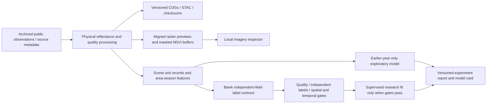

# Imagery, dataset and model architecture decisions

## Implemented flow

The existing adviser evidence brief/queue remains independent of the model
experiment. Model scores cannot silently change priorities or become confidence
percentages. The viewer and local COG endpoint serve only a bounded prepared
dataset. A COG download takes known dataset/scene/asset identifiers, not arbitrary
paths or remote URLs. Byte-range and HEAD responses support GIS readers; unknown
assets and invalid ranges do not expose local files. It is still loopback-only
with no production authentication.

## Portability and reproducibility

COGs retain spatial reference, nodata, overviews and band descriptions. STAC uses
published projection/raster extensions; official JSON schemas were checked.
Fingerprints include source observations, raw arrays, mask/grid recipe, code,
direct scientific software versions and seed. Manifest/index writes are atomic.
Versioned raster hashes are checked before reuse. Changed sources or recipes
create new IDs rather than silently modifying an experiment's input identity.
Byte-identical results are checked within the recorded environment; a full
cross-platform container/transitive lock is not supplied yet.

Public previews are presentation derivatives. Quantitative NDVI difference uses
float32 masked values, not subtraction of colorized pixels. Only the intersection
of valid observations is compared. Pixel inspection uses the actual affine grid
in meters. RGB uses a fixed stretch, not target-adaptive enhancement. Source
cloud gaps remain visible. No synthetic super-resolution or generated imagery
is used in analytics or customer-facing evidence.

## ML boundary

One area/season per row reduces repeated-acquisition inflation; it does not make
neighboring units independent. IsolationForest provides a transparent baseline
novelty experiment. The supervised pipeline's engineering gates prevent obvious
leakage and pseudo-labeling but do not certify label truth or study power.
Only manifest-linked features and blank label templates are exposed to the local
desk; independent outcome files stay in the operational workspace.

## Next architecture increments

1. Partner-confirmed crop/season geometry, field reference storage, adjudication
   and cohort freezing; proper multi-area/time validation and sampling weights.
2. Broader seasonal archives with operational availability timestamps and
   development-only threshold selection. Separate temporal novelty from geographic
   generalization and actual useful-finding-at-capacity evaluation.
3. Optional radar/weather features with independent quality contracts. Expand
   crop/region adapters without transferring Texas or Uganda validation claims.
4. Evaluate a pinned pretrained geospatial encoder only after adding its exact
   band/resolution/normalization adapter and dataset/checkpoint licence tracking.
5. Authenticated object storage, raster tiling and signed private catalogs when
   datasets outgrow bounded local previews. Continue the modular production
   architecture; do not host this unauthenticated prototype on a public interface.

Standards references: [OGC COG](https://docs.ogc.org/is/21-026/21-026.html),
[STAC projection extension](https://github.com/stac-extensions/projection),
[STAC raster extension](https://github.com/stac-extensions/raster).
