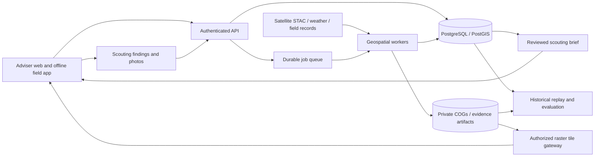

# Production architecture target

Proposed design, 20 October 2026. This supplements the implemented
[offline slice](../mvp/ARCHITECTURE.md); it does not describe deployed infrastructure.
Market rationale: [Texas assessment](TEXAS_MARKET.md).

## Additional Uganda research profile

The independent Uganda extension demonstration added on 20 October 2026 is
documented in [IDEA assessment](../idea/ASSESSMENT.md) and
[operations](../idea/OPERATIONS.md). Shared concepts are source lineage, time,
quality states, geometry, review and feedback. Texas crop/pivot eligibility,
thresholds and validation do not transfer to Uganda. The original Texas engine
remains `vantage.core`; the area-level reconstruction uses `vantage.area` and
`configs/uganda_iganga.json`. The local interface supports both, with conspicuous
real-retrospective versus synthetic labels. Uganda is a separate prospective
customer experiment, not a validated regional expansion or IDEA integration.

## Architecture decision

Use a modular application with independently executed geospatial workers and
cloud-native raster storage. Start with a single API and relational database;
separate compute-heavy raster jobs from request handling. Avoid microservices,
Kubernetes and a GPU fleet until scale or operating constraints justify them.
State of the art here means interoperable data, reproducible processing,
temporal correctness, transparent uncertainty and evaluated decisions. A complex
model is not evidence of superior performance.

## Components and standards

| Component | Proposed implementation | Responsibility |
|---|---|---|
| Web and field client | TypeScript/React, MapLibre, offline-capable PWA | Field list, evidence map, before/after, trajectories, review and findings |
| API | Python/FastAPI with versioned OpenAPI | Authorization, field/season management, queries, brief review, feedback |
| Spatial store | PostgreSQL/PostGIS with migrations | Polygon versions, tenant-scoped operational records, spatial indexes |
| Object store | Private S3-compatible buckets | Source subsets, masks, COG derivatives, photos, immutable run artifacts |
| Data discovery | STAC client and provider adapters | Search metadata, retain source identifiers and provenance |
| Raster compute | GDAL/Rasterio, NumPy/xarray; GeoPandas/Shapely for vector QA | Masking, reprojection, aggregation and reproducible features |
| Orchestration | Managed scheduler + durable queue + container workers | Idempotent acquisition/processing jobs, retry and dead-letter handling |
| Map delivery | Authorized TiTiler/raster gateway + vector endpoint | Windowed raster access and private overlays |
| Experiment tracking | Run manifests first; MLflow if models warrant it | Config/code/data versions, holdouts, metrics and approval gates |
| Operations | OpenTelemetry-compatible traces/metrics, structured logs | Data freshness, failures, latency, cost and audit visibility |

STAC has published OGC community standards [1]; COG supports selective HTTP range
reads rather than downloading entire scenes [2]. PostGIS provides geometry and
geography types and spatial indexing [3]. MapLibre supports browser vector-map
rendering [4]. These standards enable portability; exact library and service
versions must be pinned and compatibility-tested during implementation.

Do not run both a self-hosted and managed catalog without a requirement. Initially
save external STAC item snapshots and index only selected assets internally.
Use Parquet/GeoParquet for batch exports where useful; add Zarr or distributed
arrays only when multi-scene workload measurements justify them.

## Data model

Every private record carries tenant_id; use composite tenant/id foreign keys,
server-side authorization and database row-level policies. IDs alone are not
authorization. Separately model observed facts, inferred flags and human findings.

| Table/entity | Main content and invariants |
|---|---|
| tenant, membership, grower, consent | Roles, grower authorization, retention/export scope, agreement version |
| field, boundary_version | Stable field identity; valid WGS84 MultiPolygon, source, effective interval, consent; immutable boundary versions |
| field_season | Crop, planting date, confirmed irrigation system, stage history, harvest/defoliation, eligibility; crop and pivot provenance |
| zone_version | Field/boundary reference, geometry, zone method, min area/pixel rules, revision; zones must not overlap unless explicitly designed |
| management_event | Effective time and recorded time, source, adviser notes, event type; never silently replace historical context |
| source_item, raster_asset | STAC collection/item, acquisition interval, provider publication/availability when known, first_seen_at, processing baseline, checksum, scale/offset, CRS, resolution, licence |
| observation | Zone+source+pipeline version, acquired/available/processed times, bands/index statistics, area-weighted usable fraction, quality reasons, mask version |
| processing_run | Code/container digest, config hash, input checksums, attempt/state, start/end, outputs, cost and lineage |
| evidence_flag | Boundary/season/zone versions, observation pair/baseline, score units, quality state, reason components, alternative explanations, model version |
| scouting_round, brief | Decision cutoff, due fields, capacity, frozen candidate list, adviser review, final order, evidence IDs; immutable publication revisions |
| planned_visit, scouting_visit | Baseline order recorded before reveal, revised order, visit times, selected/sampled reason, nonvisit reasons |
| finding, attachment | Observed facts, uncertain/suspected/confirmed cause separately, reviewer, location accuracy, action and follow-up; private photo links |
| evaluation_case, label, claim | Event/AOI, cohort lock, reference evidence, split, reviewer, results, approved claim and limits |

Use UTC timestamps plus the user's display timezone. Preserve both event time and
the time Vantage learned the fact: retrospective replay may use only records
available by its cutoff. A reprocessed 2023 scene discovered in 2026 is not proof
that the same product was available operationally in 2023. Corrections append
revisions; do not rewrite evidence already used in a brief.

Areas/distances require a suitable projected CRS or geodesic calculation, never
degree arithmetic. Check valid topology, self intersections, holes, source CRS,
containment, overlaps, minimum effective pixel counts and boundary-edge erosion.
Store the original input and report repair decisions; do not silently redraw fields.

## Observation and analytics pipeline

1. Confirm consented boundaries, field seasons and scouting eligibility.
2. Discover candidate imagery by AOI/time and provider; scene cloud percentage is
   a discovery hint, not a field-usable-coverage estimate.
3. Read only needed windows; decode provider-specific reflectance scale/offset
   and no-data correctly. Record processing baseline; Sentinel-2 offsets changed
   with baseline 04.00, so raw digital-number NDVI can be wrong [5].
4. Mask cloud, shadow, snow, invalid/saturated pixels and optional adjacency
   buffers. Retain SCL/mask resolution and resampling details. Optical absence
   remains absence. Never render interpolated or generated pixels as observations.
5. Compute NDVI initially; evaluate EVI2 and red-edge/SWIR features later, with
   native-resolution labels. Upsampling a 20 m band does not create 10 m evidence.
6. Aggregate robust zone statistics with valid-area fractions and counts. Use
   same-field temporal comparisons and separately evaluate field-wide changes.
7. Compare against frozen baselines; suppress actionable priorities when evidence
   is stale, insufficient or out of eligible crop stage. Produce source-linked
   reason components, not unsupported causal labels.
8. Materialize an immutable brief; adviser reviews, sets visit capacity and records
   findings. Refresh only on materially new evidence or documented corrections.

Sentinel-2 L2A is the first fine-zone optical source. HLS is an optional harmonized
30 m time-series source [6]; it is not interchangeable with 10 m Sentinel-2 detail.
Nominal revisit does not guarantee clear scenes. Landsat thermal is coarser and
does not diagnose a pivot fault. Radar can add an independently validated
wetness/change layer; it is not a drop-in NDVI replacement. Weather, drought maps
and soil layers are context at their native scale, not field-specific truth.

Baseline ladder: current median-change heuristic → robust temporal and
phenology-aware baselines → supervised ranking only when sufficient independent
field labels exist. Benchmark each against the simplest rule and the adviser's
actual process. Foundation-model embeddings may be evaluated for additional
features, but must beat baselines on held-out farms/seasons, useful-findings-at-K,
coverage and cost. No zero-shot agriculture diagnosis claim. Calibrated uncertainty
requires held-out labels; until then show data sufficiency and quality, not a
fabricated probability. Keep field-wide and within-field scores distinct.

## APIs and operational semantics

Proposed routes: POST /v1/fields/import, POST /v1/field-seasons,
GET /v1/fields/{id}/observations, POST /v1/scouting-rounds,
POST /v1/scouting-rounds/{id}/briefs, GET /v1/briefs/{id},
POST /v1/visits, POST /v1/findings, GET /v1/evidence/{id}/manifest.
Imports and offline sync use idempotency keys. Brief creation returns a job ID;
heavy processing never blocks a web request. Version schemas and validate numeric,
geometric, temporal and tenant constraints at each boundary.

Keep a single container deployment for the API and separate scheduled workers
initially. Use managed database/object storage where practical, infrastructure as
code, locked dependencies, CI, migrations and secrets management. Add a second
provider only after measuring outage/freshness risk; record provider changes and
test scientific comparability. Cache derived assets by source checksum, geometry
version, pipeline and config hash. Retries must not duplicate observations.

Offline client stores only authorized, bounded downloads with expiry and visible
sync state. Persist visits with client-generated UUIDs, capture time and server
receipt time. Resolve conflicting edits explicitly. Do not assume a PWA has
unlimited storage or background-sync support on every device; field-test target phones.

Require TLS, least-privilege object access, short-lived signed links, audited role
changes, encrypted backups and restore drills. Authorize tile requests and private
cache keys; never expose private fields through public STAC metadata or shared tile
caches. Define deletion/retention for grower data, photos and derived exports.

Monitor pipeline failures, input lag, quality rejection, fresh usable field-week
coverage, time-to-brief and cost per field-week. Infrastructure uptime and usable
satellite evidence are separate service measures. Propose pilot targets only after
historical measurements; the five-day rule remains an unvalidated product policy.

## Delivery sequence and acceptance

| Stage | Deliverable | Gate |
|---|---|---|
| Existing | Offline rectangular synthetic slice | Eight behavior tests; no real imagery validation |
| 1: data foundation | Real polygon import, versioned PostGIS schema, source manifest | Representative geometry/tenant tests; no leakage; reproducible source selection |
| 2: historical processing | Cloud masks, reflectance decoding, zonal trajectories, case replay | Independent QA, correct scale/offset, explicit missingness, withheld controls |
| 3: adviser pilot product | Map/trajectory, review, offline findings, durable brief revisions | Phone field test; before-reveal baseline; consent and outcome capture |
| 4: prospective evaluation | Frozen policies and paid pilot | Outcome uncertainty, missed findings, availability and repeat-purchase evidence |
| 5: expansion | Additional crops/regions/models | New crop/region holdout and economics; no automatic transfer of claims |

These are sequence gates, not promised dates or a cloud cost estimate. Staffing,
partner access, imagery requirements and historical labels determine schedule.
No production component in this target is claimed implemented by this document.

## Technical sources

1. [OGC STAC community standards](https://www.ogc.org/announcement/ogc-announces-publication-of-the-spatiotemporal-asset-catalog-community-standards/).
2. [COG design](https://cogeo.org/in-depth.html).
3. [PostGIS manual](https://postgis.net/docs/postgis-en.html).
4. [MapLibre documentation](https://maplibre.org/maplibre-gl-js/docs/).
5. [Copernicus Sentinel-2 processing](https://sentiwiki.copernicus.eu/web/s2-processing).
6. [NASA HLS data products](https://hls.gsfc.nasa.gov/data-products/).
